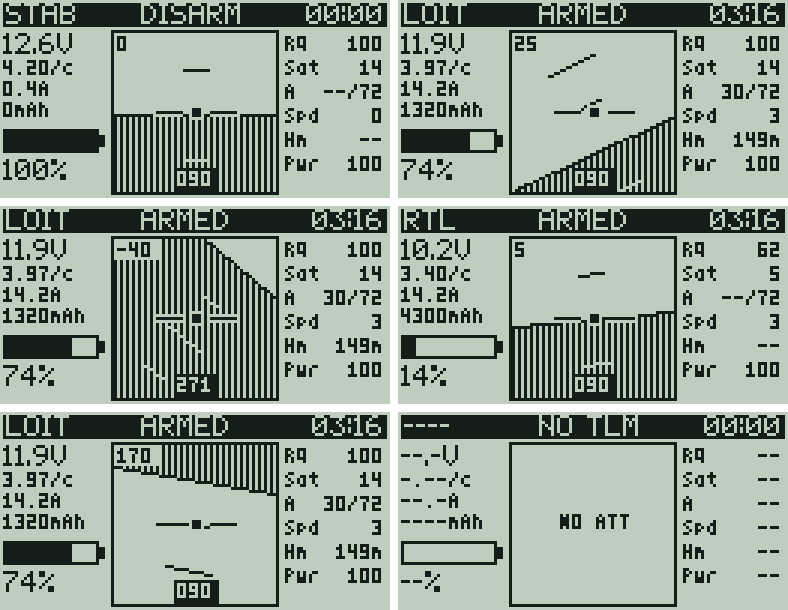

# Radio (RadioMaster Pocket, EdgeTX)

Files under `radio/` mirror the Pocket's SD card: `radio/SCRIPTS/...` goes to
`/SCRIPTS/...`.

## Telemetry screen: `SCRIPTS/TELEMETRY/quad.lua`

A single 128x64 page for ArduCopter over ELRS (plain CRSF). It replaces the
Yaapu view with less on screen.



- **Title bar:** flight mode, ARMED / DISARM / NO TLM, and a flight timer that
  runs only while armed (long ENTER resets it).
- **Left:** pack voltage, volts per cell, current, mAh used, and remaining %
  (mAh used against the pack size, else the FC's `Bat%`). Voltage blinks below
  3.50 V/cell and inverts below 3.30 V/cell; mAh blinks past 80% used.
- **Centre:** attitude indicator with a 10 degree pitch ladder, roll angle
  (top left) and heading (bottom).
- **Right:** link quality, GPS sats, altitude as `A rel/msl` (metres above
  where it armed / above sea level), ground speed, distance from where it
  armed, and TX power (mW).

It only reads the sensors EdgeTX discovers from CRSF (`FM`, `RxBt`, `Curr`,
`Capa`, `Bat%`, `RQly`, `TPWR`, `Sats`, `Alt`, `GSpd`, `GPS`, `Ptch`, `Roll`,
`Yaw`). It sends nothing to the module or the FC, so it can't change params or
the fence.

### Install

1. Copy `SCRIPTS/TELEMETRY/quad.lua` to `/SCRIPTS/TELEMETRY/` on the SD card.
2. On the radio: Model > Display > Screen 1 > Script > `quad`.
3. Discover sensors (Model > Telemetry > Discover new) with the quad powered.

### Settings

Defaults are at the top of the script (3 cells, 5000 mAh, alert thresholds).
To override them without editing the script, put a table in
`/SCRIPTS/QUAD/telem_cfg.lua`, which `quadctl` can generate from `quad.yaml`:

```lua
return { cells = 3, capacity = 5000, cellWarn = 3.5, cellCrit = 3.3 }
```

### To check on the bench

These are assumptions about EdgeTX and ArduPilot that haven't
been confirmed on this radio yet:

- Tilt the nose up: the horizon should move down. Roll right: the horizon's
  right side should rise. If not, set `pitchSign` or `rollSign` to `-1`.
- ArduPilot marks disarmed by ending the CRSF flight mode with `*`
  (`STAB*`). ARMED/DISARM and the timer depend on that.
- `NO TLM` comes from `getRSSI()` dropping to 0 when the link is lost.

### Test without the radio

- **EdgeTX Companion simulator** (macOS): add the script to the simulated SD
  card folder and fake sensor values in the Telemetry simulator tab.
- **Local harness:** `radio/test/run.sh` runs the script against a mocked
  EdgeTX API under Lua 5.2 (what EdgeTX uses) for a set of scenarios, and
  renders PNG previews into `radio/test/out/`. Needs `lua5.2` (or `lua`) and
  Python with Pillow. Its fonts are approximations of the radio's.
