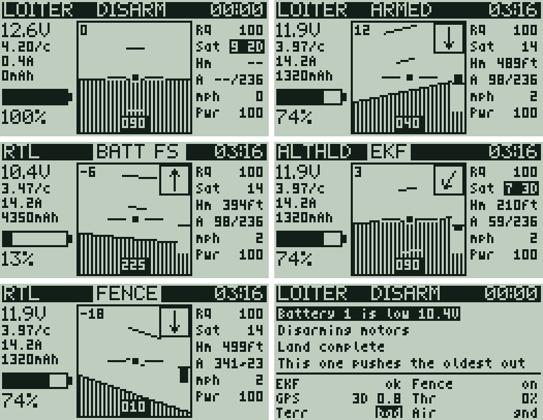

# Radio (RadioMaster Pocket, EdgeTX)

Files under `radio/` mirror the Pocket's SD card: `radio/SCRIPTS/...` goes to
`/SCRIPTS/...`.

## Telemetry screen: `SCRIPTS/TELEMETRY/quad.lua`

A 128x64 telemetry screen for ArduCopter over ELRS (CRSF). It replaces the
Yaapu view with less on screen. It works from the plain CRSF sensors alone,
and shows more when ArduPilot also sends passthrough telemetry.

With CRSF sensors only:


With passthrough (pre-arm, flying, battery failsafe, EKF warning, fence
breach with terrain height, page 2):



### Page 1

- **Title bar:** flight mode, ARMED / DISARM / NO TLM, and a flight timer that
  runs only while armed (long ENTER resets it). With passthrough, an FC alert
  replaces ARMED as a blinking white tag: `FENCE` (breach), `BATT FS`, `EKF`,
  or `FS` (any other failsafe), most urgent first.
- **Left:** pack voltage, volts per cell, current, mAh used, and remaining %
  (mAh used against the pack size, else the FC's `Bat%`). Voltage blinks below
  3.50 V/cell and inverts below 3.30 V/cell; mAh blinks past 80% used. With
  passthrough, the pack size comes from the FC's `BATT_CAPACITY`.
- **Centre:** attitude indicator with a 10 degree pitch ladder, roll angle
  (top left) and heading (bottom). An arrow (top right) points home relative
  to the nose, and a bar on the right edge shows climb rate (full scale
  5 m/s, about 1000 ft/min).
- **Right:**
  - `RQ` link quality (%), blinks below 70.
  - `Sat` GPS sats. With passthrough, a bad fix (no 3D fix, or HDOP over 2.0)
    shows inverted with the fix type, e.g. `9 2D`.
  - `Hm` distance home.
  - `A` height. Normally `rel/msl`: above home / above sea level. When the FC
    has terrain data, `agl~N`: above the ground under the quad, give or take N
    (see below). A downward rangefinder takes over when it has a reading.
  - `mph` (or `kmh`) ground speed.
  - `Pwr` TX power (mW).

Imperial by default (ft, mph, mi); set `units = "metric"` for m, km/h, km.

### Page 2

Scroll the wheel to switch pages. Page 2 shows the last 4 FC messages
(warnings and worse inverted) and a status grid: EKF, fence (on / off /
BRCH), GPS fix and HDOP, throttle, terrain data (ok / bad), and whether the
FC thinks it is flying. Messages only appear here for now; page 1 has no
message bar yet.

### Where the data comes from

- **CRSF sensors** that EdgeTX discovers: `FM`, `RxBt`, `Curr`, `Capa`,
  `Bat%`, `RQly`, `TPWR`, `Sats`, `Alt`, `GSpd`, `GPS`, `Ptch`, `Roll`, `Yaw`,
  `VSpd`.
- **Passthrough**, read with `crossfireTelemetryPop()`: ArduPilot wraps FrSky
  passthrough packets in CRSF frame `0x80` (sub-type `0xF0` single, `0xF2`
  multi, `0xF1` status text). The script decodes `0x5001` (mode, armed,
  failsafes, fence, throttle), `0x5002` (GPS fix, HDOP), `0x5004` (home
  distance, height, bearing), `0x5005` (climb rate), `0x5006` (rangefinder),
  `0x5007` (battery capacity) and `0x500B` (height above terrain). Layouts
  follow ArduPilot's `AP_Frsky_SPort_Passthrough.cpp`. Values older than 5 s
  are ignored, and each falls back to the CRSF-only behaviour.
- When passthrough is fresh it wins: mode and armed state come from `0x5001`
  instead of the CRSF flight mode string, and home is the FC's home instead
  of the point the script saves at arming.

The script sends nothing to the module or the FC, so it can't change params or
the fence.

### Sharing the CRSF queue

EdgeTX gives Lua one queue for the CRSF frames it doesn't decode itself
(ArduPilot's `0x80` passthrough frames, ELRS module parameter replies).
`crossfireTelemetryPop()` removes the oldest frame, so a frame one script pops
is gone for every other script: two scripts popping at once each lose about
half the frames. The sensors EdgeTX decodes itself (battery, GPS, attitude,
link stats) aren't affected; any script can read them with `getValue()`.

- This script pops only while a receiver is linked. The ELRS boot script from
  `quadctl` (`SCRIPTS/QUAD/elrs.lua`) pops only while none is, so they take
  turns.
- The ELRS Lua (SYS > Tools) pops while it's open, so passthrough data goes
  stale until it's closed.
- Don't run Yaapu or another passthrough script alongside this one.

If more scripts need these frames later, the plan is one central popper that
reads the queue and hands each frame to whichever script wants it, rather
than each script calling `crossfireTelemetryPop()` itself.

### Height above ground and its `~N`

ArduPilot sends height above terrain (`0x500B`) only while `TERRAIN_ENABLE` is
on and it has SRTM tiles for the area (copied to `APM/terrain/` on the FC's SD
card over USB). It sends no accuracy figure, so `N` is an estimate:
`terrErr + hdopErr * HDOP`, by default 5 m plus 2.5 m per unit of HDOP (about
23 ft at HDOP 0.8). It covers the map's error and a position error on a slope,
not barometer drift. Tune both in the settings.

### Install

1. Copy `SCRIPTS/TELEMETRY/quad.lua` to `/SCRIPTS/TELEMETRY/` on the SD card.
2. On the radio: Model > Display > Screen 1 > Script > `quad`.
3. Discover sensors (Model > Telemetry > Discover new) with the quad powered.
4. For passthrough: set the CRSF passthrough bit in `RC_OPTIONS` on the FC
   and an ELRS telemetry ratio of about 1:4 (both belong in `quadctl`).

### Settings

Defaults are at the top of the script (3 cells, 5000 mAh, alert thresholds,
units). To override them without editing the script, put a table in
`/SCRIPTS/QUAD/telem_cfg.lua`, which `quadctl` can generate from `quad.yaml`:

```lua
return { cells = 3, capacity = 5000, cellWarn = 3.5, cellCrit = 3.3, units = "imperial" }
```

### To check on the bench

These are assumptions about EdgeTX and ArduPilot that haven't
been confirmed on this radio yet:

- Tilt the nose up: the horizon should move down. Roll right: the horizon's
  right side should rise. If not, set `pitchSign` or `rollSign` to `-1`.
- Without passthrough, ArduPilot marks disarmed by ending the CRSF flight mode
  with `*` (`STAB*`). ARMED/DISARM and the timer depend on that.
- EdgeTX reports the CRSF `Alt` sensor in metres and `GSpd` in km/h, and the
  script converts from those. If the sensors were set to other units on the
  radio, the numbers will be off.
- `NO TLM` comes from `getRSSI()` dropping to 0 when the link is lost.
- EdgeTX hands `0x80` frames to Lua with the sub-type as the first payload
  byte, and the passthrough fields are little-endian. The decoder is tested
  against an encoder ported from ArduPilot, not against a real FC.
- The scroll wheel arrives as `EVT_VIRTUAL_NEXT`/`PREV` (or `EVT_ROT_*`).

### Test without the radio

- **EdgeTX Companion simulator** (macOS): add the script to the simulated SD
  card folder and fake sensor values in the Telemetry simulator tab. It can't
  fake passthrough frames.
- **Local harness:** `radio/test/run.sh` runs the script against a mocked
  EdgeTX API under Lua 5.2 (what EdgeTX uses) for a set of scenarios,
  including passthrough frames built by an encoder ported from ArduPilot, and
  checks key text on each screen. It renders PNG previews into
  `radio/test/out/`. Needs `lua5.2` (or `lua`) and Python with Pillow. Its
  fonts are approximations of the radio's.
